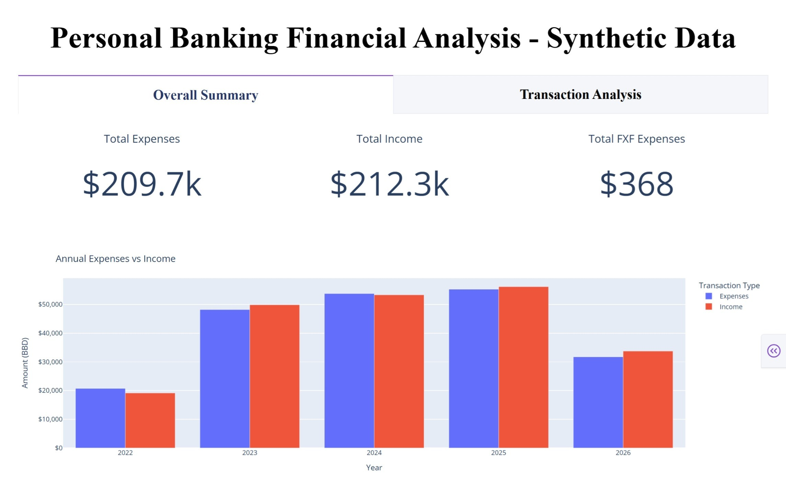

# Personal Banking Financial Analysis (Synthetic Data)
This project analyzes synthetic personal banking transactions to identify income and expenditure patterns and trends. The analysis explores financial activity at both annual and monthly levels, examines spending by entity, and uses data visualizations to communicate key findings. The project demonstrates an end-to-end data analytics workflow, from data preparation and exploration to analysis and presentation of insights.

## Analysis at a Glance
An interactive dashboard was developed to provide a visual overview of the financial analysis.



## Project Deliverables
- <a href="notebooks/"> Synthetic Data Creation & Analysis Notebooks</a>
- <a href="synthetic-data/">Synthetic Dataset</a>
- <a href="images/">Full Dashboard Screenshots</a>
- <a href="presentations/personal-banking-financial-analysis-report-synthetic-data.pdf">Project Presentation</a>

## Executive Insights
- The difference between annual income and expenses remained relatively small throughout the period. 

- Both income and expenditure reached their highest annual levels in 2025. However, the highest monthly income occurred in 2026 and the highest monthly expenditure ccurred in 2024, indicating that the annual peaks were not driven by the individual peak months.

- Spending was heavily concentrated on the top-ranked entity. Spending at this entity was nearly three times higher than at the second-ranked entity.

## Technologies & Tools
- **Python & Pandas** – Data analysis and processing
- **Matplotlib, Plotly & Dash** – Data visualization and dashboard creation
- **Jupyter Notebook** – Development and analysis environment
- **Ollama** - Semantic summarisation using an LLM
- **fpdf2** - PDF creation using synthetic data
- **PDFPlumber** - Data extraction from PDFs

### Approach
- Generated the synthetic bank statements.
- Cleaned and standardized transaction data.
- Performed exploratory data analysis and data quality checks.
- Analyzed income and expenditure at annual, monthly, overall and entity levels.
- Created visualizations to communicate the findings.

## Financial Implications
If these patterns represented actual financial activity, the analysis would suggest several areas for further investigation:

- Monitor years in which expenditure approaches or exceeds income.
- Investigate large monthly fluctuations to determine whether they represent recurring expenses or exceptional transactions.
- Track income and expenditure trends over time to identify changes in financial behavior.

## Data Privacy & Limitations
The publicly available dataset is entirely synthetic and contains no actual banking transactions or personally identifiable financial information.

Key limitations include:
- The synthetic data is designed to resemble realistic banking activity but does not represent actual financial behavior.
- The dataset provides only partial coverage for 2022 and 2026.
- Transactions represent activity from a single financial institution and therefore do not provide a complete view of overall financial activity.<br/><br/>


## Getting Started
The following instructions are intended for users who want to reproduce the analysis or run the dashboard locally.

### Prerequisites
Before you begin, ensure that you have Python 3.11.9 and <a href="https://ollama.com/download">Ollama</a> installed.

This project was tested with an NVIDIA GeForce RTX 4060 GPU and GTX 1650 GPU. Older GPUs (like NVIDIA GeForce GTX 10 & 16 Series) with outdated GPU drivers may cause Ollama to crash, so update to the latest GPU driver. *<a href="https://docs.ollama.com/gpu">Learn more about GPU requirements.</a>*

### 1. Clone the Repository
Open your terminal or command prompt and run the following commands to clone the project then navigate into the directory:
```bash
git clone https://github.com/mike-mayers/synthetic-banking-analysis.git
cd .\synthetic-banking-analysis\
```

### 2. Create a Virtual Environment (Recommended)
It is best practice to run Python scripts and notebooks inside an isolated environment to prevent package conflicts.

* **On Windows:**
  ```bash
  python -m venv .venv
  .venv\Scripts\activate
  ```
* **On macOS and Linux:**
  ```bash
  python -m venv .venv
  source .venv/bin/activate
  ```

### 3. Install Dependencies
Install the required libraries listed in the `requirements.txt` file:
```bash
pip install -r requirements.txt
```

### 4. Register the Virtual Environment Kernel
To make sure your Jupyter environment can see the dependencies installed inside the virtual environment, link it as a kernel:
```bash
python -m ipykernel install --user --name=<venv-name> --display-name "Python (<your project name>)"
```

For example: 
```bash 
python -m ipykernel install --user --name=synthetic-analysis --display-name "Python (Synthetic Analysis)"
```

### 5. Launching the Notebook
- Open any of the notebooks in your IDE (for example, VS Code).
- Once the notebook opens, ensure the correct kernel is selected. Look at the top-right corner. It should display **"Python (\<your project name>)"**. If it doesn't, click **Select Kernel** and choose the correct kernel from the dropdown.
- You can now run any of the notebooks.
